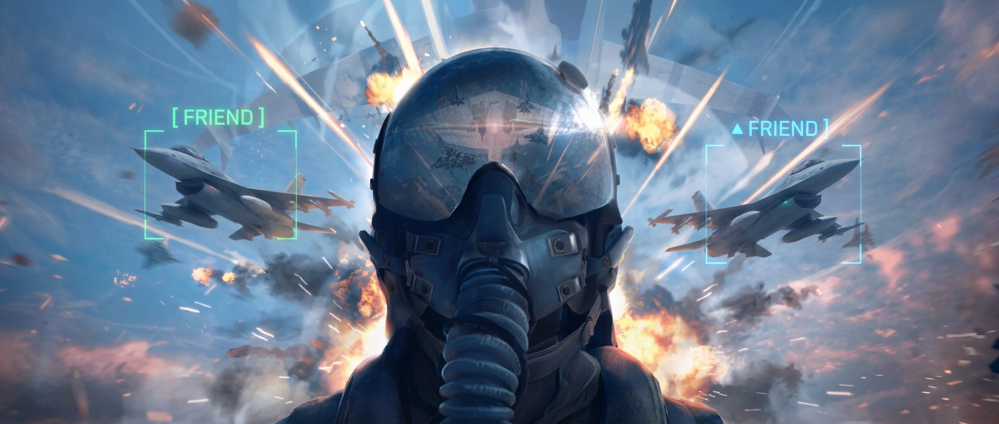
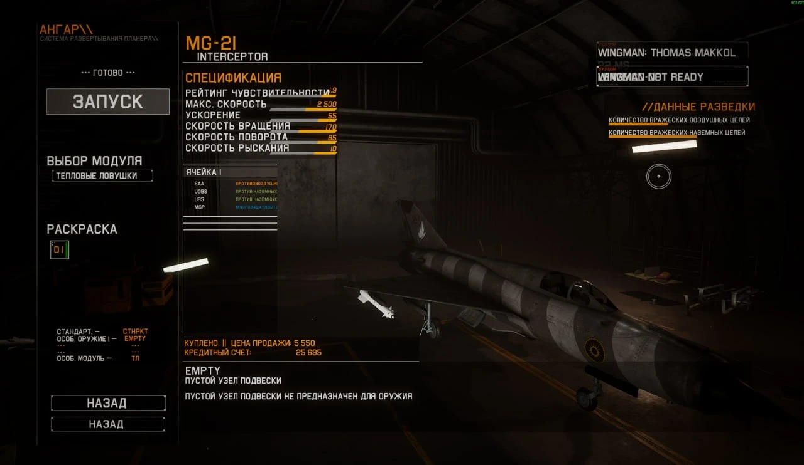

<div align="center">



# ✈️ PWCoop

### Steam co-op for **Project Wingman**

Fly together with a Steam friend: partner aircraft, shared enemies, shared kills, hangar ready-up.

[](https://github.com/exraven99-design/PWCoop/releases/latest)
[](LICENSE)
[](#install)
[](#features)
[](#known-issues)

[**⬇ Download**](https://github.com/exraven99-design/PWCoop/releases/latest) ·
[**Nexus Mods page**](https://www.nexusmods.com/projectwingman/mods/873) ·
[Report a bug](https://github.com/exraven99-design/PWCoop/issues)

</div>

> ⚠️ **Alpha.** Unofficial fan mod, not affiliated with the game's developers. Written with AI assistance. Expect bugs.

---

## Features

| | |
|---|---|
| 🧑‍✈️ **Partner wingman** | Your friend's real aircraft model with nozzles, afterburner, guns, all missile types and bombs, name tag with distance, health % line under TOTAL SCORE |
| 🎯 **Shared enemies** | Positions of enemy aircraft and ships are synced from the host; kills of ground units, ships and aircraft are repeated for the other player |
| 🛫 **Hangar ready-up** | LAUNCH becomes a co-op ready button, the mission starts for both when both are ready |
| 💥 **Shared fail** *(experimental)* | If one player dies the other gets critical damage too; Retry / Hangar / Quit is repeated for the partner |
| 🗺️ **Missions + Free Flight** | Story missions and Free Flight both work (with limitations, see below) |
| 🌍 **8 languages** | Menu texts localized |

## Screenshots

<p align="center">
  <br>
  <sub>Hangar: LAUNCH works as a co-op ready button, the partner's name and READY status are shown top right</sub>
</p>
<p align="center">
  <br>
  <sub>In flight with the partner: missile trail, name tag and HUD</sub>
</p>
<p align="center">
  
  
  <br><sub>Co-op in the main menu: friend invites and status notifications</sub>
</p>

## Install

1. Download `PWCoop_Setup_0.2.0.zip` from [Releases](https://github.com/exraven99-design/PWCoop/releases/latest) (or from [Nexus Mods](https://www.nexusmods.com/projectwingman/mods/873)).
2. Close the game. **Extract the whole zip** to any folder (do not run from inside the zip).
3. Run `PWCoop_Setup.exe`, press Enter at the end.
4. Start the game from Steam. **ADD FRIEND** appears top right.

**Both players need the same mod version** and must be Steam friends. Requires Project Wingman (Unreal Engine 4.27 build) and Steam running.

Uninstall: `PWCoop_Setup.exe --uninstall` (UE4SS stays), or delete `Mods\PWCoop` and the `PWCoop : 1` line in `Mods\mods.txt`.

> The installer and helper are built with PyInstaller and are not code-signed, so some antivirus engines show generic false positives. VirusTotal for the zip: [0 / 66](https://www.virustotal.com/gui/file/fd858794bb85112b7dbb5beacf42bcc5825252f16848455c5f8f91294bf565b0). Everything is built from the source in this repository (see [Build](#build)).

## Known issues

- Pause is not shared.
- Mission / Free Flight choice is not repeated automatically for the guest: pick the same one manually (the host's choice is shown on a plate).
- Mission phases, objectives and scripted events run on each game separately; only positions and kills are synced.
- Gamepad/keyboard "confirm" on the original Launch can bypass the ready button, use the mouse on LAUNCH.
- Some enemy aircraft can look slightly jerky for the guest.
- Shared fail and Retry/Hangar/Quit repeat are new and little tested.
- Only 2 players.

## How it works

```
Project Wingman ── UE4SS (Lua: Mods/PWCoop/Scripts) ──┐
                                                      │ small text files (Mods/PWCoop/io/)
                         pwcoop_helper.exe (Python) ──┘
                                  │  game's own steam_api64.dll
                                  ▼
                       Steam Networking Messages (Steam relay)  ◄──►  your friend
```

- **Lua scripts** read your aircraft state and show the partner.
- **Helper** talks to Steam through the game's own `steam_api64.dll` (friends list, invites, P2P messages) and exchanges small text files with the Lua scripts. No own servers, no analytics, no admin rights.

**Sent to the partner (only after the invite is accepted):** aircraft position/rotation/speed/health/afterburner/crash flag, shot counter, missile/bomb id + position + model names, nearby enemy positions and kill events (host), hangar ready/go/follow flags, selected mission/mode, Steam display name, model/nozzle layout, control messages.
**Never sent:** files, screenshots, chat, passwords, e-mail.

## Repository layout

| Path | What it is |
|---|---|
| `Mods/PWCoop/Scripts/main.lua`, `ui.lua` | the mod: Lua scripts for UE4SS (plain text, run inside the game) |
| `coop/steam_helper.py` | background helper (Steam via `steam_api64.dll`, file exchange with Lua) |
| `coop/installer.py` | installer: finds the game, copies UE4SS (if absent) and the mod, enables `PWCoop : 1` in `Mods/mods.txt` |
| `coop/build_installer.py` | build script (PyInstaller) that produces the release zip |

[UE4SS](https://github.com/UE4SS/UE4SS) v3.0.1 is bundled unmodified in the release zip (`UE4SS.dll`, `dwmapi.dll`); it is not part of this repository.

## Build

Requirements: Windows, Python 3.11+, `pip install pyinstaller psutil`, Project Wingman with UE4SS v3.0.1 installed (so `UE4SS.dll`, `dwmapi.dll`, `UE4SS-settings.ini` exist in its `Win64` folder).

```bat
set PW_WIN64=C:\Program Files (x86)\Steam\steamapps\common\Project Wingman\ProjectWingman\Binaries\Win64
python coop/build_installer.py
```

Result: `dist_installer/PWCoop_Setup_0.2.0.zip` (the same files as the release; `--onedir --noupx`, version info embedded).

## Bug reports

Open an [issue](https://github.com/exraven99-design/PWCoop/issues) or comment on Nexus. Include what you did, Free Flight or mission, who was the host (the one who invited), and these files from `ProjectWingman\Binaries\Win64` **before restarting the game**: `UE4SS.log` and `Mods\PWCoop\io\helper.log` (lines with `[PWCoop]`).

## Roadmap

Automatic repeat of the host's mission choice, shared pause, host-side mission phases/objectives, smoother enemy movement for the guest, soft respawn.

## Credits & license

Code: [MIT](LICENSE). Thanks to the [UE4SS](https://github.com/UE4SS/UE4SS) authors. Steamworks API is used through the game's own `steam_api64.dll`. Project Wingman © its developers; this mod is not endorsed by them.
